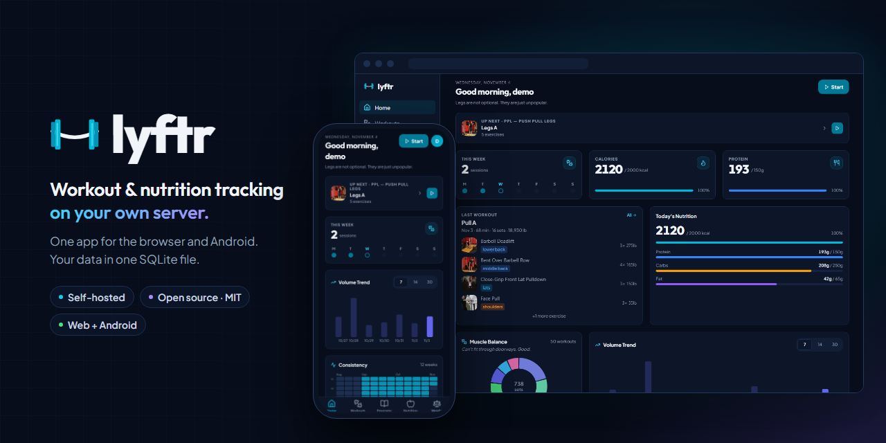
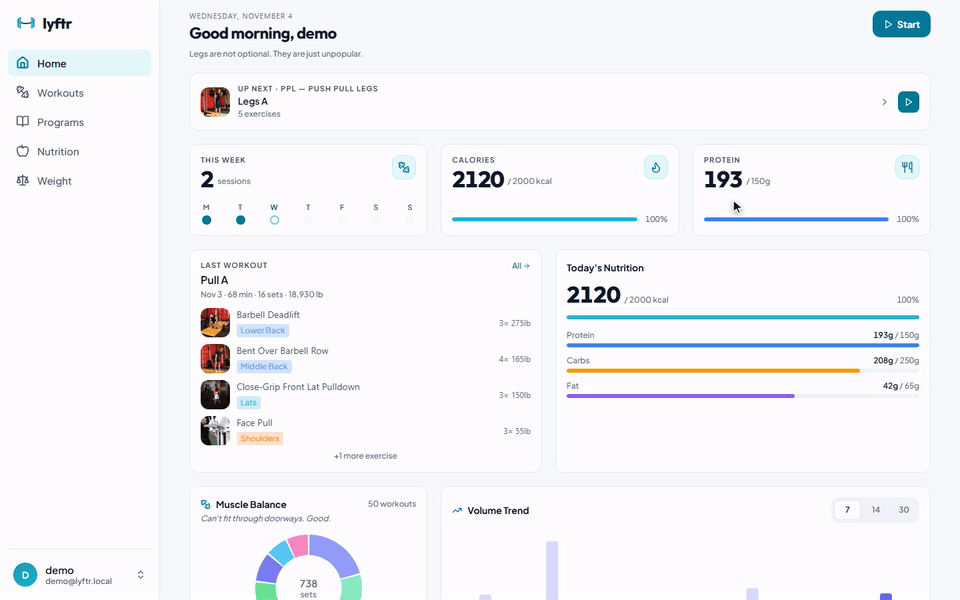

<p align="center">
  
</p>

<p align="center">
  <b>Self-hosted workout &amp; nutrition tracker.</b><br />
  Free, open source, and yours to run. One app for the browser and Android, one SQLite file for your data.
</p>

<p align="center">
  <a href="https://lyftr-demo.fly.dev">Live demo</a> ·
  <a href="https://lyftr-app.pages.dev">Docs</a> ·
  <a href="https://github.com/Cawlumm/lyftr/releases">Download APK</a> ·
  <a href="https://discord.gg/hfFWsrebQA">Discord</a>
</p>

<!-- include_prereleases is load-bearing: every release ships prerelease:true (see
     eas-build.yml), so nothing is marked "latest" and the plain badge renders
     "no releases or repo not found". Same reason the links above point at /releases
     rather than /releases/latest, which 302s to the list anyway. -->
<p align="center">
  <a href="LICENSE"></a>
  
  <a href="https://github.com/Cawlumm/lyftr"></a>
  <a href="https://selfh.st/weekly/2026-04-24/"></a>
  <a href="https://github.com/Cawlumm/lyftr/releases"></a>
  
</p>

---

## What is Lyftr?

A workout tracker you run yourself. Log sessions from reusable programs, follow a guided Gym Mode
with a rest timer, and keep nutrition and bodyweight next to your training. Everything you log
lives in a single SQLite file on your server.

No subscription, no cloud account, nothing to export: the database is already yours.

<p align="center">
  
</p>

## Features

| | |
|---|---|
| **Workouts** | Exercise library of 800+ exercises with photos and instructions, a program builder, and set-by-set logging with a rest timer |
| **Gym Mode** | One exercise at a time with large controls; a focused dialog on desktop, full screen on a phone |
| **Progress** | Personal bests and a weight-progression chart per exercise, a muscle diagram, and a dashboard with volume trend, muscle balance and a 12-week consistency heatmap |
| **Nutrition** | Calories and macros against your own targets, food search and barcode scanning (via Open Food Facts), macro trends |
| **Weight** | Bodyweight log with a trend chart, in lbs or kg |
| **Everywhere** | One app: a sidebar layout on desktop, a tab bar on phones, and an Android build. Light and dark themes, English and Spanish |
| **Yours** | Self-hosted with Docker on amd64, arm64 or armv7. One SQLite file, and registration you can leave open, limit to the first user, or close |

## Quick start

No clone, no build, just Docker:

```bash
curl -o docker-compose.yml https://raw.githubusercontent.com/Cawlumm/lyftr/main/docker-compose.yml
curl -o .env https://raw.githubusercontent.com/Cawlumm/lyftr/main/.env.example
# set JWT_SECRET in .env to a long random string (openssl rand -hex 32), then:
docker compose pull && docker compose up -d
```

Open `http://localhost` and create your account. Anyone who can reach the instance can register
until you set `REGISTRATION`, so read
[locking down registration](https://lyftr-app.pages.dev/configuration/#locking-down-registration)
before giving it a public hostname.

The [docs](https://lyftr-app.pages.dev) cover the rest:
[configuration](https://lyftr-app.pages.dev/configuration/),
[HTTPS and reverse proxies](https://lyftr-app.pages.dev/https/),
[backups and updates](https://lyftr-app.pages.dev/backups/),
[the Android app](https://lyftr-app.pages.dev/mobile/) and
[troubleshooting](https://lyftr-app.pages.dev/troubleshooting/).

## Try it

- **Live demo**: [lyftr-demo.fly.dev](https://lyftr-demo.fly.dev). One tap signs you in, or use
  `demo@lyftr.local` / `password123`. It resets hourly. That account exists only on the demo;
  your own install has no default login.
- **Android**: [download the APK](https://github.com/Cawlumm/lyftr/releases) from the newest
  release and point it at your server ([mobile docs](https://lyftr-app.pages.dev/mobile/)).
- **iOS**: planned, and blocked on an Apple Developer account rather than on the code (see
  [Support](#support)).

## Status

Beta. Lyftr is actively built and every release is published as a prerelease, so expect rough
edges and frequent updates. Back up `data/lyftr.db` before you upgrade
([how](https://lyftr-app.pages.dev/backups/)). The software equivalent of going to the gym for
the first time.

## Tech stack

Go · Gin · SQLite for the API. One Expo / React Native app in TypeScript with NativeWind, exported
to the web through react-native-web and served by nginx. Astro · Starlight for the docs. Docker
Compose to run it.

## Translations

Lyftr ships in English and Spanish. Help translate it into your language: see
[CONTRIBUTING.md](CONTRIBUTING.md#translations).

## Contributing

Bug reports, feature requests, translations, and PRs are welcome. Open an issue before large
changes. Start with [CONTRIBUTING.md](CONTRIBUTING.md) for setup and conventions, and
[docs/TESTING.md](docs/TESTING.md) for how the test suite is organised.

## Support

Lyftr is free and open source under the MIT license. Run it on your own hardware, no subscription.

The most useful things you can do are free: file a reproducible bug report, fix a doc page that was
wrong, or tell another self-hoster it exists.

If you'd rather help with the running costs, sponsorship covers the demo server (~$4/month) and the
developer accounts Lyftr needs to reach more platforms. The iOS app is blocked on a $99/year Apple
Developer account, not on the code.

[Sponsor on GitHub](https://github.com/sponsors/Cawlumm) · [All the ways to help](https://lyftr-app.pages.dev/support/)

## License

[MIT](LICENSE)
